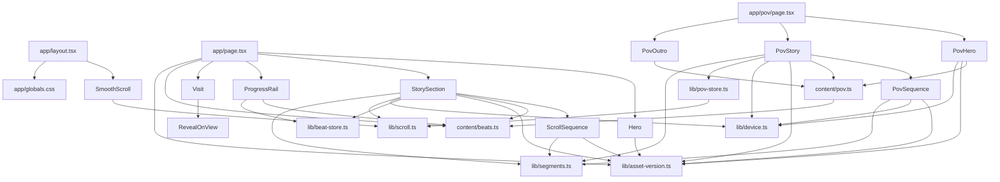

# 04 - Architecture

Everything in this file was read from the source in `/home/user/bakersfield`. Where a code comment and the code disagree, the code is documented and the mismatch is listed under "Known quirks" at the end.

Conventions: "server" = React Server Component (no `'use client'`). "client" = file starts with `'use client'`. All paths are relative to the repository root. The alias `@/` means `src/`.

---

## 1. Stack, versions, scripts, config

### 1.1 Dependencies (exact, from `package.json`; all pinned with no `^` or `~`)

| Package | Version | Kind |
|---|---|---|
| `next` | `15.5.28` | dependency |
| `react` | `19.3.1` | dependency |
| `react-dom` | `19.3.1` | dependency |
| `gsap` | `3.15.0` | dependency (uses `gsap` and `gsap/ScrollTrigger`) |
| `lenis` | `1.3.27` | dependency (default export `Lenis`) |
| `@fontsource/pixelify-sans` | `5.3.0` | dependency (weights 400 and 700 CSS imported) |
| `@fontsource-variable/dm-sans` | `5.3.0` | dependency (`index.css`, family name `'DM Sans Variable'`, weight axis `100 1000`) |
| `typescript` | `5.9.3` | devDependency |
| `@types/node` | `22.20.5` | devDependency |
| `@types/react` | `19.3.0` | devDependency |
| `@types/react-dom` | `19.3.0` | devDependency |
| `eslint` | `9.39.4` | devDependency |
| `eslint-config-next` | `15.5.28` | devDependency |
| `@eslint/eslintrc` | `3.3.7` | devDependency (FlatCompat) |

`package.json`: `"name": "bakersfield"`, `"version": "0.1.0"`, `"private": true`. No `engines` field, no `.nvmrc`, no `vercel.json`, no `.vercel` folder in the repo. A Node requirement is therefore NOT stated. (Next 15 needs Node 18.18+; the author's machine ran Node `v22.23.4`, and `@types/node` is 22.x. This is inferred, not stated in the repo.)

### 1.2 Scripts

| Script | Command |
|---|---|
| `dev` | `next dev` |
| `build` | `next build` |
| `start` | `next start -p 3000` |
| `lint` | `eslint src eslint.config.mjs next.config.mjs` |

There is no `test` script and no test framework. `npm run lint` and `npx tsc --noEmit --incremental false` both pass with zero output on the current source.

### 1.3 Config files

**`next.config.mjs`** (ESM). Full content that matters:

```js
const nextConfig = {
  reactStrictMode: true,
  poweredByHeader: false,
  async headers() {
    const immutable = [{ key: 'Cache-Control', value: 'public, max-age=31536000, immutable' }];
    return [
      { source: '/frames/:path(.+\\.webp)', headers: immutable },
      { source: '/frames-sm/:path(.+\\.webp)', headers: immutable },
      { source: '/brand/:path(.+\\.webp)', headers: immutable },
      { source: '/pov/:slug/:file(.+\\.webp)', headers: immutable },
      { source: '/pov-sm/:slug/:file(.+\\.webp)', headers: immutable },
    ];
  },
};
export default nextConfig;
```

The exact header: key `Cache-Control`, value `public, max-age=31536000, immutable`. The five source patterns are exactly the five above. Comment in the file: image files only; URLs carry `?v=<ASSET_VERSION>` so the long cache is safe; `/pov` and `/pov-sm` have sub-paths for the images only, so the `/pov` page HTML is not matched. No `images`, `redirects`, `rewrites`, `experimental` or `output` setting. `reactStrictMode: true` means effects run twice in `next dev` (mount, cleanup, mount); the code is written to survive that (every effect has a cleanup).

**`tsconfig.json`**: `target` `ES2020`; `lib` `["dom","dom.iterable","esnext"]`; `allowJs` `false`; `skipLibCheck` `true`; `strict` `true`; `noEmit` `true`; `esModuleInterop` `true`; `module` `esnext`; `moduleResolution` `bundler`; `resolveJsonModule` `true`; `isolatedModules` `true`; `jsx` `preserve`; `incremental` `true`; `plugins` `[{ "name": "next" }]`; `paths` `{ "@/*": ["./src/*"] }` (no `baseUrl`); `include` `["next-env.d.ts","**/*.ts","**/*.tsx",".next/types/**/*.ts"]`; `exclude` `["node_modules"]`.

**`eslint.config.mjs`** (flat config): `FlatCompat({ baseDirectory: __dirname })`; ignores `".next/**"`, `"node_modules/**"`, `"out/**"`, `".claude/**"`, `"next-env.d.ts"`; extends `next/core-web-vitals` and `next/typescript`. The `lint` script limits scope to `src`, `eslint.config.mjs`, `next.config.mjs`. Inline disables used in source: `@next/next/no-img-element` (several ``), `@next/next/no-html-link-for-pages` (one, in `PovOutro.tsx`).

**`.gitignore`**: `node_modules/`, `.next/`, `out/`, `.env*.local`, `*.tsbuildinfo`, `next-env.d.ts`, `.DS_Store`, `.claude/worktrees/`.

**`assets/brand/BRAND.md`** (brand sheet, not code): logo = pixel croissant with dark brown French moustache; palette Cream `#F6E7CA` (background), Butter `#FAD488` (highlight), Honey `#F9B35F`, Amber `#EA9346`, Bake `#D06C2E` (croissant), Crust `#A8572D` (accent), Mustache `#462217` (ink). Headings/display = Pixelify Sans (large sizes only; wordmark, section titles, big numbers). Body/UI = DM Sans. Rule: "body text is the constraint. Pixel face is for display only." Voice: "Warm, plain and proud. Short sentences. No invented facts (menu, prices, hours and location come from the client)." Logo source `assets/brand/logo-mark-source.jpg`.

### 1.4 Fonts

Fonts come from npm packages, not `next/font`. `src/app/layout.tsx` imports:

```
@fontsource/pixelify-sans/400.css
@fontsource/pixelify-sans/700.css
@fontsource-variable/dm-sans/index.css
```

All `@font-face` rules use `font-display: swap` and unicode-range subsets (cyrillic, latin-ext, latin for Pixelify; DM Sans Variable has its own subset set). Pixelify Sans is only ever used at `font-weight: 700` in the CSS (the 400 file is imported but no rule asks for weight 400 on a Pixelify element). There is no `<link rel="preload">` for fonts.

---

## 2. File tree

### 2.1 `src/`

```
src/
  app/
    layout.tsx                 server  root layout, metadata, viewport, skip link, <SmoothScroll/>
    page.tsx                   server  "/"  pixel version
    globals.css                tokens + global rules
    icon.png                   64x64  (Next file-based favicon)
    apple-icon.png             180x180 (Next file-based apple touch icon)
    pov/
      page.tsx                 server  "/pov"  photoreal version
  components/
    SmoothScroll.tsx           client  Lenis + GSAP ticker + #beat- click handling
    Hero.tsx                   server  home hero
    Hero.module.css
    StorySection.tsx           client  home pinned story
    StorySection.module.css
    ScrollSequence.tsx         client  home canvas frame engine
    ScrollSequence.module.css
    ProgressRail.tsx           client  home fixed side rail (8 dots)
    ProgressRail.module.css
    Visit.tsx                  server  home closing section
    Visit.module.css
    RevealOnView.tsx           client  reveal-once wrapper (used by Visit)
    RevealOnView.module.css
    pov/
      PovHero.tsx              server
      PovHero.module.css
      PovStory.tsx             client  pov pinned story
      PovStory.module.css
      PovSequence.tsx          client  pov canvas frame engine (cover fit + cross-fade)
      PovSequence.module.css
      PovOutro.tsx             server
      PovOutro.module.css
  content/
    beats.ts                   home content model + types (also exports FrameSet)
    pov.ts                     pov content model + types
  lib/
    asset-version.ts           ASSET_VERSION, withVersion
    beat-store.ts              home external store (zone, segment)
    pov-store.ts               pov external store + pov segment Y registry
    device.ts                  PHONE_QUERY, isPhone, isCoarsePointer, wantsSmallFrames, stableViewportHeight
    scroll.ts                  smoother holder, beat Y registry, scrollToY, scrollToBeat
    segments.ts                segmentAt, localAt
```

Line counts (for orientation): `layout.tsx` 37, `page.tsx` 36, `pov/page.tsx` 20, `globals.css` 224, `SmoothScroll.tsx` 73, `StorySection.tsx` 319, `ScrollSequence.tsx` 328, `PovStory.tsx` 301, `PovSequence.tsx` 365.

### 2.2 Public asset layout

Image files exist under `public/` (served from the site root). Counts were taken with `ls <dir> | wc -l`; sizes with PIL.

| Folder | Subfolders | Files per subfolder | Naming | Pixel size (all files) |
|---|---|---|---|---|
| `public/frames/` | `ingredients dough lamination proof bake mustache` | 61 = 60 frames + `poster.webp` | `0001.webp` ... `0060.webp`, `poster.webp` | 720 x 720 (366 files checked, all identical size) |
| `public/frames-sm/` | same six | 42 = 41 frames + `poster.webp` | `0001.webp` ... `0041.webp`, `poster.webp` | 480 x 480 (252 files) |
| `public/pov/` | same six | 52 = 51 frames + `poster.webp` | `0001.webp` ... `0051.webp`, `poster.webp` | 960 x 540 (312 files) |
| `public/pov-sm/` | same six | 40 = 39 frames + `poster.webp` | `0001.webp` ... `0039.webp`, `poster.webp` | 640 x 360 (240 files) |
| `public/brand/` | none | 1 file: `logo-mark.webp` | - | 512 x 512 (11,710 bytes) |

Sizes on disk (`du -sh`): `public/frames` 4.3M, `frames-sm` 2.0M, `pov` 6.3M, `pov-sm` 2.9M, `brand` 16K.

Frame numbers are 4-digit zero-padded, starting at `0001` (`pad = String(n).padStart(4,'0')`, called with `i + 1`). Counts in code: home full 60, home small 41, pov full 51, pov small 39 (constants in `src/content/beats.ts` and `src/content/pov.ts`, matching the files above). The poster of each segment is `poster.webp` in the same folder. Only the first segment's poster (`ingredients/poster.webp`) is used on the live pinned pages; the other posters are used only in the reduced-motion lists.

The favicon files `src/app/icon.png` (64 x 64) and `src/app/apple-icon.png` (180 x 180) are Next metadata files. They are not under `public/`. In the existing `.next` build they render as `<link rel="icon" href="/icon.png?<hash>" type="image/png" sizes="64x64"/>` and `<link rel="apple-touch-icon" href="/apple-icon.png?<hash>" type="image/png" sizes="180x180"/>`.

---

## 3. Per-file specification

### 3.1 `src/lib/asset-version.ts`

```ts
export const ASSET_VERSION = '2';
export function withVersion(url: string): string   // returns `${url}?v=${ASSET_VERSION}`
```
Example: `withVersion('/frames/dough/0001.webp')` -> `/frames/dough/0001.webp?v=2`. CSS files cannot import it and hardcode `?v=2` (only `PovOutro.module.css` does: `url('/pov/ingredients/0001.webp?v=2')` and `url('/pov-sm/ingredients/0001.webp?v=2')`). Bumping the constant means also editing those two CSS URLs.

### 3.2 `src/lib/segments.ts`

```ts
const clamp01 = (n: number) => (n < 0 ? 0 : n > 1 ? 1 : n);   // not exported
export function segmentAt(progress: number, count: number): number
export function localAt(progress: number, count: number, segment: number): number
```
- `segmentAt`: `if (count <= 0) return 0; return Math.min(count - 1, Math.floor(clamp01(progress) * count + 1e-9));` The `1e-9` epsilon stops a boundary value such as `4/6` from flooring to the previous segment.
- `localAt`: `clamp01(clamp01(progress) * count - segment)`.

### 3.3 `src/lib/device.ts`

```ts
export const PHONE_QUERY = '(max-width: 767px), (max-width: 932px) and (max-height: 500px)';
export function isPhone(): boolean              // window.matchMedia(PHONE_QUERY).matches
export function isCoarsePointer(): boolean      // window.matchMedia('(pointer: coarse)').matches
export function wantsSmallFrames(): boolean
export function stableViewportHeight(): number
```
- Private: `const SLOW_CONNECTIONS: readonly string[] = ['slow-2g', '2g', '3g'];` and types `NetworkInformationLike = { saveData?: boolean; effectiveType?: string }`, `NavigatorWithConnection = Navigator & { connection?: NetworkInformationLike }`.
- `wantsSmallFrames()`: `true` if `isPhone()`; else read `(navigator as NavigatorWithConnection).connection`; if absent `false`; `true` if `connection.saveData === true`; else `true` only if `typeof effectiveType === 'string'` and it is in `SLOW_CONNECTIONS`; otherwise `false`. Comment says "Call once, on mount." Both story components call it once in a mount effect.
- `stableViewportHeight()`: creates a `div`, `aria-hidden="true"`, `style.cssText = 'position:fixed;top:0;left:0;width:0;height:100vh;height:100svh;visibility:hidden;pointer-events:none'`, appends to `document.body`, reads `getBoundingClientRect().height`, removes it; returns that height if `> 0` else `window.innerHeight`. (A browser that does not know `svh` keeps the `100vh` declaration.)
- Meaning: the phone query matches narrow screens (width <= 767px, any height) and short landscape phones (width <= 932px and height <= 500px). A 768px-wide window never matches, even with a short height above 500px.

### 3.4 `src/lib/scroll.ts`

```ts
import type Lenis from 'lenis';
let smoother: Lenis | null = null;
const pinnedBeatY = new Map<string, () => number>();
export function setSmoother(instance: Lenis | null): void
export function registerBeatY(slug: string, getY: () => number): () => void
export function scrollToY(y: number): void
export function scrollToBeat(slug: string): boolean
```
- `registerBeatY`: sets the map entry; the returned function deletes the entry only if it still holds the same `getY` function.
- `scrollToY(y)`: if a smoother exists -> `smoother.scrollTo(y, { duration: 1.2 })`. Else `window.scrollTo({ top: y, behavior: reduce ? 'auto' : 'smooth' })` where `reduce = window.matchMedia('(prefers-reduced-motion: reduce)').matches`.
- `scrollToBeat(slug)`: if a registered `getY` exists -> `scrollToY(getY()); return true`. Else look up `document.getElementById('beat-' + slug)`; if missing `return false`; else `scrollToY(el.getBoundingClientRect().top + window.scrollY); return true`.
- Only the home page registers beat Y values (`StorySection`). `PovStory` uses `pov-store.ts` instead but calls `scrollToY` from this file.

### 3.5 `src/lib/beat-store.ts` (home state)

```ts
export type BeatZone = 'hero' | 'story' | 'visit';
export type BeatState = { zone: BeatZone; segment: number };
export function getBeatState(): BeatState
export function subscribeBeatState(listener: () => void): () => void
export function setBeatState(zone: BeatZone, segment: number): void
export function useBeatState(): BeatState
```
Module-level `initial = { zone: 'hero', segment: 0 }`, mutable `state = initial`, `listeners = new Set<() => void>()`. `setBeatState` returns early if both fields equal, else assigns a NEW object and calls every listener. `useBeatState` = `useSyncExternalStore(subscribeBeatState, getBeatState, () => initial)` (server snapshot = `initial`). `segment` is 0..5 and only meaningful in zone `'story'`.

### 3.6 `src/lib/pov-store.ts` (pov state + registry)

```ts
export type PovZone = 'hero' | 'story' | 'outro';
export type PovState = { zone: PovZone; segment: number };
export function getPovState(): PovState
export function subscribePovState(listener: () => void): () => void
export function setPovState(zone: PovZone, segment: number): void
export function usePovState(): PovState
export function registerPovY(slug: string, getY: () => number): () => void
export function scrollToPovBeat(slug: string): boolean
```
Same store logic as 3.5 with zone names `'hero' | 'story' | 'outro'`. Plus a module `beatY` Map. `registerPovY` same register/unregister pattern as `registerBeatY`. `scrollToPovBeat(slug)`: `const getY = beatY.get(slug); if (!getY) return false; scrollToY(getY()); return true;` (imports `scrollToY` from `@/lib/scroll`). Returns false when the story is not pinned (e.g. reduced motion).

### 3.7 `src/content/beats.ts` and `src/content/pov.ts`

See section 4 (content model).

### 3.8 `src/app/layout.tsx` (server)

Exports `metadata: Metadata`, `viewport: Viewport`, default `RootLayout({ children }: Readonly<{ children: React.ReactNode }>)`.
- Side-effect imports in this order: `@fontsource/pixelify-sans/400.css`, `@fontsource/pixelify-sans/700.css`, `@fontsource-variable/dm-sans/index.css`, `./globals.css`. Imports `{ SmoothScroll }` from `@/components/SmoothScroll`.
- `metadata`: `title: 'Bakersfield'`; `description: 'Bakersfield is a bakery. Follow the croissant from flour to oven.'`; `appleWebApp: { title: 'Bakersfield', statusBarStyle: 'default' }`. Comment: favicon and Apple icon come from `src/app/icon.png` and `src/app/apple-icon.png`. No `title.template`, no openGraph, no `metadataBase`.
- `viewport`: `{ width: 'device-width', initialScale: 1, viewportFit: 'cover', themeColor: '#f6e7ca' }`.
- Rendered: `<html lang="en"><body><a className="skip-link" href="#main">Skip to content</a><SmoothScroll />{children}</body></html>`. `skip-link` is a global class (see 05). Target `#main` is the `<main id="main">` of each page.
- The built HTML (observed in `.next/server/app/index.html`) additionally contains `<meta name="mobile-web-app-capable" content="yes"/>`, `<meta name="apple-mobile-web-app-title" content="Bakersfield"/>`, `<meta name="apple-mobile-web-app-status-bar-style" content="default"/>`, `<meta name="theme-color" content="#f6e7ca"/>`, `<meta name="viewport" content="width=device-width, initial-scale=1, viewport-fit=cover"/>`.

### 3.9 `src/app/page.tsx` (server, route `/`)

Imports: `preload` from `react-dom`; `Hero`, `StorySection`, `ProgressRail`, `Visit`; `beats`, `sequenceBeats` from `@/content/beats`; `withVersion`.
Body of `Home()`:
```ts
const hero = beats.find((beat) => beat.kind === 'hero');
const visit = beats.find((beat) => beat.kind === 'outro');
const first = sequenceBeats[0];
preload(withVersion(`${first.frames.dir}/0001.${first.frames.ext}`), { as: 'image', fetchPriority: 'low', media: '(min-width: 768px)' });
preload(withVersion(`${first.framesSm.dir}/0001.${first.framesSm.ext}`), { as: 'image', fetchPriority: 'low', media: '(max-width: 767px)' });
```
Resulting preload hrefs: `/frames/ingredients/0001.webp?v=2` with media `(min-width: 768px)`, and `/frames-sm/ingredients/0001.webp?v=2` with media `(max-width: 767px)`, both `as="image"` `fetchPriority="low"`. (Rendered in the build as `<link rel="preload" href="/frames/ingredients/0001.webp?v=2" as="image" fetchPriority="low" media="(min-width: 768px)"/>`.) The build also contains `<link rel="preload" as="image" href="/brand/logo-mark.webp?v=2" fetchPriority="high"/>`, which React emits for the hero ``.
Composition order: `<> <main id="main">{hero && <Hero beat={hero} />}<StorySection />{visit && <Visit beat={visit} />}</main><ProgressRail /></>`. `ProgressRail` is outside `<main>`. No `metadata` export in this file (inherits the layout's).

### 3.10 `src/app/pov/page.tsx` (server, route `/pov`)

`metadata`: `title: "Bakersfield — the baker's view"` (em dash U+2014, straight apostrophe), `description: "Follow a Bakersfield croissant from flour to oven, filmed from the baker's side of the counter."`. Composition: `<main id="main"><PovHero /><PovStory /><PovOutro /></main>`. No `preload()` calls and no `ProgressRail`. `SmoothScroll` still runs (from the root layout), and the skip link is also present.

### 3.11 `src/components/SmoothScroll.tsx` (client)

`export function SmoothScroll(): null`. Module scope: `gsap.registerPlugin(ScrollTrigger)`, `const BEAT_LINK = '#beat-'`. One `useEffect(..., [])`:
1. Adds a `document` `click` listener `onClick`: ignores if `event.defaultPrevented || event.button !== 0`, or any of `metaKey ctrlKey shiftKey altKey`, or `!(event.target instanceof Element)`. Finds `event.target.closest('a[href^="#beat-"]')`; if none return. `slug = href.slice('#beat-'.length)`. `if (scrollToBeat(slug)) event.preventDefault();` (when `scrollToBeat` returns false the browser's native anchor jump proceeds.)
2. `reduce = matchMedia('(prefers-reduced-motion: reduce)')`, `coarse = matchMedia('(pointer: coarse)')`. Lenis is started only if `!reduce.matches && !coarse.matches` (evaluated once at mount, no change listeners).
3. When started: `new Lenis({ duration: 1.1, easing: (t: number) => Math.min(1, 1.001 - Math.pow(2, -10 * t)), wheelMultiplier: 1, touchMultiplier: 1.2 })`; `setSmoother(lenis)`; `lenis.on('scroll', () => ScrollTrigger.update())`; `gsap.ticker.add(time => lenis.raf(time * 1000))`; `gsap.ticker.lagSmoothing(0)`. All other Lenis options are library defaults (version 1.3.27: `smoothWheel: true`, `syncTouch: false`, `autoRaf: false`, `orientation: 'vertical'`, `lerp: 0.1` but the numeric `duration` makes it duration-driven, `respectReducedMotion: true`, `anchors: false`).
4. Cleanup: remove the click listener; if Lenis was started: `setSmoother(null)`, `gsap.ticker.remove(onTick)`, `lenis.off('scroll', onLenisScroll)`, `lenis.destroy()`. (`lagSmoothing(0)` is not restored.)
5. Renders nothing. No `ScrollTrigger.scrollerProxy` is used: Lenis scrolls the window and ScrollTrigger reads the real scroll position.

### 3.12 `src/components/Hero.tsx` (server)

`export function Hero({ beat }: { beat: Beat }): JSX.Element`. Imports `Beat` type, `withVersion`, `./Hero.module.css`.
DOM:
```
<section id="beat-hero" class="hero" aria-labelledby="hero-title">
  <div class="inner">
    <div class="mark">
      
    </div>
    <h1 id="hero-title" class="wordmark">{beat.title}</h1>      -> "Bakersfield"
    <p class="tagline">{beat.body}</p>                          -> "A croissant with character."
  </div>
  <a class="scroll" href="#beat-ingredients"><span>Scroll</span><span class="arrow" aria-hidden="true"></span></a>
</section>
```
(`id` is `beat-${beat.slug}` = `beat-hero`.) The logo is the LCP image; comment: load it first, never lazily. There is no JS in this component; the entrance is CSS only.

### 3.13 `src/components/StorySection.tsx` (client) - see also section 6

Exports: `export function StorySection(): JSX.Element`. Module scope:
`gsap.registerPlugin(ScrollTrigger); ScrollTrigger.config({ ignoreMobileResize: true });`

Constants:

| Name | Value |
|---|---|
| `VH_PER_BEAT` | `1.3` |
| `VH_PER_BEAT_PHONE` | `0.85` |
| `SEGMENTS` | `sequenceBeats.length` = 6 |
| `FRAME_SETS` | `sequenceBeats.map(b => b.frames)` |
| `SMALL_FRAME_SETS` | `sequenceBeats.map(b => b.framesSm)` |
| `STORY_POSTER` | `withVersion(sequenceBeats[0].poster)` = `/frames/ingredients/poster.webp?v=2` |
| `STORY_POSTER_SM` | `withVersion(sequenceBeats[0].posterSm)` = `/frames-sm/ingredients/poster.webp?v=2` |
| `STORY_ALT` | `'A croissant being made, from simple ingredients to a golden bake.'` |
| `pad2` | `n => String(n).padStart(2,'0')` |
| `beatProgress(i)` | `(i + 0.005) / SEGMENTS` |

`pinLength()`: `phone = isPhone(); vh = isCoarsePointer() ? stableViewportHeight() : window.innerHeight; return Math.round(vh * (phone ? VH_PER_BEAT_PHONE : VH_PER_BEAT) * SEGMENTS);`

`StoryPoster()` (private): `<picture class="picture"><source media={PHONE_QUERY} srcSet={STORY_POSTER_SM}/></picture>`.

State/refs: `mode: 'pending'|'pinned'|'reduced'` (init `'pending'`); `frameSet: 'full'|'small'|null` (init `null`); `sectionRef: HTMLElement`; `seqRef: ScrollSequenceHandle`; `panelRefs: (HTMLDivElement|null)[]`; `{ zone, segment } = useBeatState()`.

Effects:
1. `[]`: `mq = matchMedia('(prefers-reduced-motion: reduce)')`; `update = () => setMode(mq.matches ? 'reduced' : 'pinned')`; call once; `mq.addEventListener('change', update)`; cleanup removes. (So the mode follows live changes of the preference.)
2. `[]`: `setFrameSet(wantsSmallFrames() ? 'small' : 'full')`. Never changes again.
3. `[mode]` pinned effect: returns early unless `mode === 'pinned'` and the section exists. Creates `gsap.context(() => {...}, section)` containing `showPanel`, `apply`, one `ScrollTrigger.create`, `registerBeatY` calls and the hash jump. Cleanup: `ctx.revert()` (kills the ScrollTrigger, removes the pin spacer and inline styles); inside the context the returned function unregisters the beat Y entries. Does NOT reset the beat store on cleanup.
4. `[mode]` reduced effect: returns unless `mode === 'reduced'`. IntersectionObserver over the elements with ids `beat-hero`, `beat-<slug>` x6, `beat-visit` (only those found), options `{ rootMargin: '-45% 0px -45% 0px', threshold: 0 }`. For each intersecting entry: `beat-hero` -> `setBeatState('hero', 0)`; `beat-visit` -> `setBeatState('visit', SEGMENTS - 1)`; else `setBeatState('story', index)`. Cleanup `observer.disconnect()`.

Rendering:
- `lead = <div class="lead" aria-hidden="true" />`, rendered before the section in both modes.
- `mode === 'reduced'`: `<>{lead}<section id="story" class="list" aria-label="The croissant story"><ol class="listInner">` then for each beat `<li id="beat-<slug>" class="item"><picture class="picture"><source media={PHONE_QUERY} srcSet={withVersion(beat.posterSm)}/></picture><div class="card"><p class="num" aria-hidden="true">{pad2(beat.index)}</p><h2 id="beat-<slug>-title" class="title">{beat.title}</h2><p class="body">{beat.body}</p></div></li>`.
- Otherwise (`'pending'` and `'pinned'` render the same markup; server HTML is the `'pending'` render):
```
{lead}
<section ref id="story" class="section" aria-label="The croissant story">
  {6x <span id="beat-<slug>" class="anchor" aria-hidden="true"/>}
  <div class="stage">
    <div class="media">
      {mode==='pinned' && frameSet!==null
        ? <ScrollSequence ref={seqRef} segments={small?SMALL_FRAME_SETS:FRAME_SETS} poster={small?STORY_POSTER_SM:STORY_POSTER} alt={STORY_ALT} concurrency={small?4:6} capToFrame={small}/>
        : <StoryPoster/>}
    </div>
    <div class="copy">
      <div class="panels">
        {6x <div ref=panelRefs[i] class="panel"><p class="num" aria-hidden="true">{pad2(beat.index)}</p><h2 id="beat-<slug>-title" class="title">{beat.title}</h2><p class="body">{beat.body}</p></div>}
      </div>
      <div class="bar" aria-hidden="true">
        {6x <span class="cell" data-state="future|current|past"/>}
      </div>
    </div>
  </div>
</section>
```
Cell state: `zone !== 'story' ? 'future' : i === segment ? 'current' : i < segment ? 'past' : 'future'`. `small = frameSet === 'small'`.

### 3.14 `src/components/ScrollSequence.tsx` (client) - see section 5

### 3.15 `src/components/ProgressRail.tsx` (client)

`export function ProgressRail(): JSX.Element`. Imports `beats`, `useBeatState`, styles. `const LAST = beats.length - 1;` (= 7). `active = zone === 'hero' ? 0 : zone === 'visit' ? LAST : segment + 1`.
DOM: `<nav class="rail" aria-label="Beats"><ol class="list">` then for each of the 8 beats `<li><a class="link" href="#beat-<slug>" aria-label="{i+1}. {beat.title}" aria-current={isActive ? 'step' : undefined} data-active="true|false"><span class="dot" aria-hidden="true"/></a></li>`. Slugs in order: `hero ingredients dough lamination proof bake mustache visit`. Labels: `1. Bakersfield`, `2. Four simple things`, `3. Into the dough`, `4. Layer by layer`, `5. Time to rise`, `6. Golden in the oven`, `7. The finishing touch`, `8. Come say bonjour`. Clicks are handled globally by `SmoothScroll`'s `#beat-` handler (this component has no click handler). Not rendered on `/pov`.

### 3.16 `src/components/Visit.tsx` (server)

`export function Visit({ beat }: { beat: Beat }): JSX.Element`. `const YEAR = new Date().getFullYear();` at module scope (computed at build time because the page is prerendered).
DOM:
```
<section id="beat-visit" class="visit" aria-labelledby="visit-title">
  <RevealOnView className={styles.card}>          // renders <div class="card reveal" data-armed? data-shown>
    <p class="num" aria-hidden="true">08</p>
    <h2 id="visit-title" class="title">{beat.title}</h2>      "Come say bonjour"
    <p class="body">{beat.body}</p>                           "The croissant is ready. So are we."
    <div class="actions">
      <a class="button" href="#">Come say bonjour</a>          // {/* TODO: real contact details from client */}
      <a class="secondaryLink" href="/pov">See the baker&apos;s view</a>
    </div>
  </RevealOnView>
  <p class="foot">© Bakersfield {YEAR}</p>
</section>
```
Comment in code: a plain `<a>` is used for `/pov` because Next prefetching `/pov` would leave its CSS preload unused on this page. The `.num` text `08` is a literal in this file (not derived from `beat.index`, which is 8 too).

### 3.17 `src/components/RevealOnView.tsx` (client)

`export function RevealOnView({ className, children }: { className?: string; children: ReactNode }): JSX.Element`. State `armed` (false), `shown` (false); ref `HTMLDivElement`.
- `useLayoutEffect([])`: return if no element or no `IntersectionObserver` in window, or `matchMedia('(prefers-reduced-motion: reduce)').matches`. `rect = el.getBoundingClientRect(); inView = rect.top < window.innerHeight && rect.bottom > 0; if (!inView) setArmed(true);`.
- `useEffect([])`: no IO -> `setShown(true)` and return. Else `new IntersectionObserver(entries => { if (!entries.some(e => e.isIntersecting)) return; setShown(true); observer.disconnect(); }, { threshold: 0.15 })`, observe, cleanup disconnect.
- Render `<div ref className={className ? `${className} ${styles.reveal}` : styles.reveal} data-armed={armed ? 'true' : undefined} data-shown={shown ? 'true' : 'false'}>{children}</div>`.
- Server HTML: `data-shown="false"`, no `data-armed` -> content visible without JavaScript.

### 3.18 `src/components/pov/PovHero.tsx` (server)

`export function PovHero(): JSX.Element`. `first = povSequenceBeats[0]`.
```
<section class="hero" aria-labelledby="pov-hero-title">
  <picture>
    <source media={PHONE_QUERY} srcSet={withVersion(povHero.imageSm)}/>        // /pov-sm/ingredients/0001.webp?v=2
       // /pov/ingredients/0001.webp?v=2
  </picture>
  <div class="scrim" aria-hidden="true"/>
  <div class="content">
    
    <h1 id="pov-hero-title" class="wordmark rise" style="--d:70ms">Bakersfield</h1>
    <p class="line rise" style="--d:140ms">From the baker's side of the counter.</p>
  </div>
  <a class="scroll rise" style="--d:260ms" href="#pov-ingredients">Scroll<svg class="arrow" width=14 height=14 viewBox="0 0 14 14" aria-hidden="true"><path d="M7 2v9m0 0L3.5 7.5M7 11l3.5-3.5" fill="none" stroke="currentColor" strokeWidth="1.6" strokeLinecap="round" strokeLinejoin="round"/></svg></a>
</section>
```
The `<picture>` has no class, so it is an inline element in the DOM (the `.picture` rule in the CSS is unused by this component). The logo is decorative (`alt=""`); comment says the wordmark names the brand.

### 3.19 `src/components/pov/PovStory.tsx` (client) - see sections 5 and 6

Exports `export function PovStory(): JSX.Element`. Private `Progress({ zone, segment }: { zone: string; segment: number })`.
Constants:

| Name | Value |
|---|---|
| `VH_PER_BEAT` | `1.3` |
| `VH_PER_BEAT_PHONE` | `0.85` |
| `FADE_SPAN` | `0.08` |
| `SEGMENTS` | `povSequenceBeats.length` = 6 |
| `FRAME_SETS` / `SMALL_FRAME_SETS` | from `povSequenceBeats[].frames` / `.framesSm` |
| `POSTER` | `withVersion(povSequenceBeats[0].poster)` = `/pov/ingredients/poster.webp?v=2` |
| `POSTER_SM` | `withVersion(povSequenceBeats[0].posterSm)` = `/pov-sm/ingredients/poster.webp?v=2` |
| `HASH_PREFIX` | `'#pov-'` |
| `beatNumber(index)` | `` `${pad2(index)} / ${pad2(POV_BEAT_TOTAL)}` `` -> `02 / 07` ... `07 / 07` |
| `beatProgress(i)` | `(i + 0.005) / SEGMENTS` |

State/refs: `mode`, `frameSet` (same types and meaning as home), `sectionRef`, `seqRef: PovSequenceHandle`, `panelRefs`, `panelsRef: HTMLDivElement` (the `.panels` wrapper), `{ zone, segment } = usePovState()`.
Effects: (1) motion preference, (2) frame set choice, (3) pinned effect `[mode]` whose cleanup is `ctx.revert(); setPovState('hero', 0);` (extra versus home).
Pinned render:
```
<section ref class="section" aria-labelledby="pov-story-title">      // NOTE: no id on the section
  <h2 id="pov-story-title" class="srOnly">How a Bakersfield croissant is made</h2>
  {6x <span id="pov-<slug>" class="anchor" aria-hidden="true"/>}
  <div class="stage">
    <div class="media">
      {mode==='pinned' && frameSet!==null
        ? <PovSequence ref segments={small?SMALL_FRAME_SETS:FRAME_SETS} poster={POSTER} posterSm={POSTER_SM} alt={POV_STORY_ALT} concurrency={small?4:6} capToFrame={small} fit="cover" cuts={POV_CUT_SEGMENTS} fadeSpan={FADE_SPAN}/>
        : <picture><source media={PHONE_QUERY} srcSet={POSTER_SM}/></picture>}
    </div>
    <div class="copy">
      <div ref={panelsRef} class="panels">
        {6x <div ref=panelRefs[i] class="panel"><p class="num" aria-hidden="true">{beatNumber(beat.index)}</p><h3 class="title">{beat.title}</h3><p class="body">{beat.body}</p></div>}
      </div>
      <Progress zone segment/>      // <div class="bar" aria-hidden="true">6x <span class="cell" data-state=.../></div>
    </div>
    <nav class="rail" aria-label="Story steps">
      {6x <button type="button" class="railButton" aria-label="{beat.title}, step {i+1} of 6" aria-current={zone==='story'&&segment===i ? 'step' : undefined} onClick={() => scrollToPovBeat(beat.slug)}><span class="railDot" data-active={zone==='story'&&segment===i}/></button>}
    </nav>
  </div>
</section>
```
`data-active` receives a boolean, React renders it as `"true"` / `"false"`. Reduced render:
```
<section class="list" aria-labelledby="pov-story-title">
  <h2 id="pov-story-title" class="srOnly">How a Bakersfield croissant is made</h2>
  <ol class="listInner">
    {6x <li id="pov-<slug>" class="item">
      <picture><source media={PHONE_QUERY} srcSet={withVersion(beat.posterSm)}/></picture>
      <div class="card"><p class="num" aria-hidden="true">{beatNumber(beat.index)}</p><h3 class="title">{beat.title}</h3><p class="body">{beat.body}</p></div>
    </li>}
  </ol>
</section>
```

### 3.20 `src/components/pov/PovSequence.tsx` (client) - see section 5

### 3.21 `src/components/pov/PovOutro.tsx` (server)

`export function PovOutro(): JSX.Element`; `year = new Date().getFullYear()` computed inside the function (still static at build because the page is prerendered).
```
<section class="outro" aria-labelledby="pov-outro-title">
  <div class="inner">
    <h2 id="pov-outro-title" class="title">Come say bonjour</h2>
    <p class="body">The croissant is ready. So are we.</p>
    <div class="actions">
      <a class="cta" href="#">Come say bonjour</a>                  // {/* TODO: real contact details from client */}
      <a class="secondary" href="/">See the pixel version</a>
    </div>
  </div>
  <p class="footer">&copy; Bakersfield {year}</p>
</section>
```
Plain `<a href="/">` (comment: Next prefetching `/` would put the home page's frame preload on this page). The lint disable `@next/next/no-html-link-for-pages` is attached to this link.

### 3.22 CSS module files

Documented in `handoff/05-design-and-motion.md`. Each component imports exactly its own `*.module.css` (`ScrollSequence` -> `ScrollSequence.module.css`, `PovSequence` -> `PovSequence.module.css`, etc.). `globals.css` is imported once, from `layout.tsx`.

---

## 4. Content model (verbatim)

### 4.1 Types (`src/content/beats.ts`)

```ts
export type BeatKind = 'hero' | 'sequence' | 'outro';
export type FrameSet = {
  dir: string;               // public folder, e.g. /frames/dough
  count: number;             // number of frames; "0 means the frames are not delivered yet" (comment)
  ext: 'webp' | 'jpg';
};
export type Beat = {
  id: string; slug: string;
  index: number;             // position in the page, 1 for the hero
  title: string; body: string; kind: BeatKind;
  frames?: FrameSet;         // comment: Desktop frames, 720px
  poster?: string;
  framesSm?: FrameSet;       // comment: Small frames for phones and slow connections, 480px
  posterSm?: string;
};
export type SequenceBeat = Beat & { frames: FrameSet; poster: string; framesSm: FrameSet; posterSm: string };
export const beats: readonly Beat[];
export const sequenceBeats: readonly SequenceBeat[];   // beats.filter(kind === 'sequence' && all four frame fields defined)
```
Builder (private): `sequence(slug, index, id, title, body)` returns `{ id, slug, index, title, body, kind: 'sequence', frames: { dir: '/frames/<slug>', count: 60, ext: 'webp' }, poster: '/frames/<slug>/poster.webp', framesSm: { dir: '/frames-sm/<slug>', count: 41, ext: 'webp' }, posterSm: '/frames-sm/<slug>/poster.webp' }`.

### 4.2 Home beats (`beats`, in order; id equals slug for all)

| index | id / slug | kind | title | body |
|---|---|---|---|---|
| 1 | `hero` | hero | `Bakersfield` | `A croissant with character.` |
| 2 | `ingredients` | sequence | `Four simple things` | `Flour, butter, water and yeast. Every croissant starts here.` |
| 3 | `dough` | sequence | `Into the dough` | `The four come together and the dough turns smooth.` |
| 4 | `lamination` | sequence | `Layer by layer` | `Butter is folded in, again and again. Each fold makes new layers.` |
| 5 | `proof` | sequence | `Time to rise` | `The croissant takes its shape. Then it rests and grows.` |
| 6 | `bake` | sequence | `Golden in the oven` | `The oven glows. The croissant turns a deep golden brown.` |
| 7 | `mustache` | sequence | `The finishing touch` | `One fine French moustache. Now it is a Bakersfield.` |
| 8 | `visit` | outro | `Come say bonjour` | `The croissant is ready. So are we.` |

Sequence beats carry `frames`/`poster`/`framesSm`/`posterSm` as built above (e.g. `ingredients`: `/frames/ingredients`, `/frames/ingredients/poster.webp`, `/frames-sm/ingredients`, `/frames-sm/ingredients/poster.webp`). Note the slug `mustache` (US spelling) while copy says "moustache".

Other home copy (in components): hero logo alt `Bakersfield logo: a pixel croissant with a moustache`; scroll link label `Scroll` (href `#beat-ingredients`); `STORY_ALT` `A croissant being made, from simple ingredients to a golden bake.`; story section `aria-label` `The croissant story`; beat number `02`..`07` (zero-padded `beat.index`), visit number literal `08`; visit CTA label `Come say bonjour` href `#` (TODO comment: `real contact details from client`); secondary link `See the baker's view` (source `See the baker&apos;s view`) href `/pov`; footer `© Bakersfield {YEAR}`; skip link `Skip to content` href `#main`; rail nav `aria-label="Beats"`, link labels listed in 3.15. Metadata title `Bakersfield`, description `Bakersfield is a bakery. Follow the croissant from flour to oven.`

### 4.3 POV types and content (`src/content/pov.ts`)

```ts
import type { FrameSet } from '@/content/beats';
export type PovBeatKind = 'hero' | 'sequence' | 'outro';
export type PovBeat = { id: string; slug: string; index: number; title: string; body: string; kind: PovBeatKind };
export type PovSequenceBeat = PovBeat & { frames: FrameSet; poster: string; framesSm: FrameSet; posterSm: string };
export const povHero: { readonly title; readonly line; readonly image; readonly imageSm } // as const
export const povSequenceBeats: readonly PovSequenceBeat[];
export const POV_BEAT_TOTAL = 7;
export const POV_CUT_SEGMENTS: readonly number[] = [4, 5];
export const povOutro: { title; body; cta; secondary } // as const
export const POV_STORY_ALT: string;
```
Builder `sequence(slug, index, title, body)`: `id = slug`, `kind: 'sequence'`, `frames: { dir: '/pov/<slug>', count: 51, ext: 'webp' }`, `poster: '/pov/<slug>/poster.webp'`, `framesSm: { dir: '/pov-sm/<slug>', count: 39, ext: 'webp' }`, `posterSm: '/pov-sm/<slug>/poster.webp'`.

`povHero`: `title: 'Bakersfield'`, `line: "From the baker's side of the counter."`, `image: '/pov/ingredients/0001.webp'`, `imageSm: '/pov-sm/ingredients/0001.webp'`.

| index | slug | title | body |
|---|---|---|---|
| 2 | `ingredients` | `Four simple things` | `Flour, butter, water and yeast. Nothing else is needed.` |
| 3 | `dough` | `Into the dough` | `Water meets flour. A few turns, and it comes together.` |
| 4 | `lamination` | `Layer by layer` | `Butter is folded in, again and again. This is where the flakes come from.` |
| 5 | `proof` | `Shape and rest` | `One cut, one roll. Then time does the work.` |
| 6 | `bake` | `Into the oven` | `It rises, it opens, it turns gold.` |
| 7 | `mustache` | `The finishing touch` | `One fine moustache, in dark chocolate. Now it is a Bakersfield.` |

`povOutro`: `title: 'Come say bonjour'`, `body: 'The croissant is ready. So are we.'`, `cta: 'Come say bonjour'`, `secondary: 'See the pixel version'`.
`POV_STORY_ALT`: `A first-person view of a croissant being made on a marble worktop, from flour to a golden bake.`
Other POV copy in components: story h2 (screen-reader only) `How a Bakersfield croissant is made`; hero scroll label `Scroll` (href `#pov-ingredients`); beat numbers `02 / 07` ... `07 / 07`; rail nav `aria-label="Story steps"`, button labels `<title>, step <n> of 6` (e.g. `Four simple things, step 1 of 6`); outro footer `© Bakersfield {year}`; outro CTA href `#` (TODO `real contact details from client`), secondary href `/`. Doc comments: `POV_BEAT_TOTAL` is "Number shown as '02 / 07': hero is 01, the last sequence beat is 07."; `POV_CUT_SEGMENTS` are "Segments that start with a hard cut to a different shot (proof to bake, bake to mustache)". Indices are segment indices: `4` = `bake` (starts after `proof`), `5` = `mustache` (starts after `bake`).

---

## 5. The frame engines

Both engines are one client component each: a stage `div`, a `canvas`, and a poster. The parent calls `ref.current.setProgress(p)` with global progress 0..1 from a ScrollTrigger callback. `setProgress` is cheap (no React state); React state exists only for `frameMode` and `posterState`.

### 5.1 `ScrollSequence` (home)

Props (`ScrollSequenceProps`):
```ts
segments: readonly FrameSet[];  // frame sets played back to back as one flat list
poster: string;                 // already-versioned URL
alt: string;
concurrency: number;            // parallel downloads (StorySection passes 4 small / 6 full)
capToFrame: boolean;            // cap backing store (true for the small set)
ref?: Ref<ScrollSequenceHandle>
```
`ScrollSequenceHandle = { setProgress: (progress: number) => void }`, exposed with `useImperativeHandle(ref, () => ({ setProgress: p => engineRef.current?.setProgress(p) }), [])`.

Constants: `LOGO_SRC = withVersion('/brand/logo-mark.webp')`; `MAX_DPR = 2`; `LOAD_MARGIN = '150% 0px 150% 0px'`; `CAP_FACTOR = 2`; status codes `TODO=0, LOADING=1, DONE=2, FAILED=3`; `pad(n)` 4-digit; `clamp01`.

React state: `frameMode: boolean` (false), `posterState: 'pending'|'ok'|'failed'` ('pending'). Refs: `stageRef`, `canvasRef`, `engineRef`.

Effect A (`[poster]`): creates `new Image()`, `onload -> setPosterState('ok')`, `onerror -> setPosterState('failed')`, `src = poster`; cleanup nulls the handlers. Reason in comment: a failed image can finish before hydration so `onError` on the JSX element would be missed.

Effect B (`[segments, concurrency, capToFrame]`): the engine.

1. Bail if no stage/canvas or no 2D context.
2. Virtual frame list: `offsets[s]` = index of the first frame of segment `s` in the flat list; `urls[k] = withVersion(`${set.dir}/${pad(i + 1)}.${set.ext}`)`. `total = urls.length` (360 full / 246 small); return if 0. `segmentCount = segments.length` (6).
3. `frameIndexFor(p)`:
```ts
const seg = segmentAt(p, segmentCount);
const count = segments[seg].count;
const local = localAt(p, segmentCount, seg);
return offsets[seg] + Math.max(0, Math.round(local * (count - 1)));
```
So global progress `p` splits into 6 equal parts (`segmentAt`: `min(5, floor(clamp01(p)*6 + 1e-9))`), local `= clamp01(clamp01(p)*6 - seg)`, frame within segment `= round(local * (count-1))` (JS `Math.round`: halves round up) giving 0..59 (full) or 0..40 (small). Segment `s` start in the flat list: full `60*s`, small `41*s`.
4. Variables: `cancelled=false, rafId=0, progress=0, lastTarget=-1, drawn=-1, active=false, focusSeg=0, running=0, nativeSize=0, shown=false`; `frames: (HTMLImageElement|null)[] = new Array(total).fill(null)`; `status = new Uint8Array(total)`.
5. `sizeCanvas()`: `rect = stage.getBoundingClientRect(); dpr = Math.min(window.devicePixelRatio || 1, 2); w = rect.width*dpr; h = rect.height*dpr; if (capToFrame && nativeSize > 0) { k = Math.min(1, (nativeSize * 2) / Math.max(w, h)); w *= k; h *= k; } canvas.width = Math.max(1, Math.round(w)); canvas.height = Math.max(1, Math.round(h)); drawn = -1;`. `nativeSize` = `naturalWidth` of the first frame that loads (480 on the small set). So the small-set backing store's longer side is capped at 960 px. The full set is not capped beyond DPR 2.
6. `draw()`: `target = frameIndexFor(progress)`. Nearest-loaded fallback: scan `i = target` downwards to 0 for the first non-null `frames[i]`; if none, scan `i = target+1` upwards. If none found or `src === drawn`, return. Fit (contain): `scale = Math.min(cw/iw, ch/ih)`, `dw = iw*scale`, `dh = ih*scale`; `ctx.imageSmoothingEnabled = true; ctx.imageSmoothingQuality = 'high'; ctx.clearRect(0,0,cw,ch); ctx.drawImage(img, (cw-dw)/2, (ch-dh)/2, dw, dh); drawn = src`. (Smoothing is re-set on each draw because a canvas resize resets context state.)
7. `schedule()`: if `rafId !== 0` return; `rafId = requestAnimationFrame(() => { rafId = 0; if (!cancelled) draw(); })`. At most one rAF pending; no rAF loop when idle.
8. `loadFrame(i)`: `new Image()`, `decoding = 'async'`, resolves the image on load, `null` on error; `src = urls[i]`.
9. `pickNext()` (next frame to fetch): `target = frameIndexFor(progress)`; for `seg` of `[focusSeg, focusSeg + 1]` (skip if `seg >= segmentCount`): scan all frames of that segment with `status === TODO`; distance is `|i - target|` for the focus segment (nearest to the wanted frame first) and `i - start` for the next segment (in order from its first frame); take the smallest; return the first segment's best if any, else try the next; return `-1` if nothing. Nothing outside the focus segment and the one after it is ever requested.
10. `pump()`: return if `cancelled || !active`; `while (running < concurrency) { i = pickNext(); if (i < 0) return; status[i] = LOADING; running++; loadFrame(i).then(img => { running--; if (cancelled) return; if (img) { status[i] = DONE; frames[i] = img; if (nativeSize === 0) { nativeSize = img.naturalWidth; sizeCanvas(); } if (!shown) { shown = true; setFrameMode(true); } schedule(); } else { status[i] = FAILED; } pump(); }) }`. Failed frames are not retried.
11. `setProgress(p)`: `progress = clamp01(p)`; `seg = segmentAt(progress, segmentCount)`; if `seg !== focusSeg` then `focusSeg = seg; pump();`; `target = frameIndexFor(progress)`; if `target === lastTarget` return; `lastTarget = target; schedule();`. So drawing is scheduled only when the target frame index changes.
12. `engineRef.current = { setProgress }`. `sizeCanvas()`. `ResizeObserver` on the stage: `sizeCanvas(); schedule();`.
13. Loading gate: if `'IntersectionObserver' in window`: `new IntersectionObserver(entries => { if (!entries.some(e => e.isIntersecting)) return; io.disconnect(); io = null; start(); }, { rootMargin: '150% 0px 150% 0px' })` observing the stage; `start = () => { active = true; pump(); }`. Without IO: `start()` immediately. The stage lies inside the pinned section, which starts about 1.14 viewport heights down the page (hero 100svh + lead band 14svh), so it is already inside the `150%` margin at page load; the gate mainly protects mounting when the stage is far off-screen. Before the gate opens nothing is fetched and `pump` is a no-op.
14. Cleanup: `cancelled = true; io?.disconnect(); ro.disconnect(); cancelAnimationFrame(rafId) if pending; engineRef.current = null; setFrameMode(false)`.

Poster / fallback rendering:
```
<div ref=stage class="stage">
  <canvas ref class="canvas" role="img" aria-label={alt} hidden={!frameMode}/>
  {!frameMode && (posterState !== 'failed'
     ?                           // visible while 'pending' and 'ok'
     : <div class="fallback"></div>)}
</div>
```
The canvas is `display:none` (global `[hidden]`) until the first frame decodes, then the poster element is removed from the DOM. The fallback (poster file missing) shows the logo on `var(--stage)`.

Initial load order (derived): `focusSeg = 0`, target = frame 0 -> the first 6 (or 4) requests are frames `0001, 0002, ...` of `ingredients` (nearest to target 0), then the rest of segment 0 in order, then segment 1 in order (`0001`...). Home total requested without any scrolling: 2 segments = 120 frames (full) or 82 (small). Moving into segment `k` re-targets the loader: remaining TODO frames of segment `k` nearest to the current target first, then segment `k+1` in order. Segments that were skipped by a fast scroll are never fetched until the focus reaches them or the one before them.

Reduced motion: the engine is never mounted (see `StorySection`: `mode` must be `'pinned'`).

URL construction: `withVersion(`${set.dir}/${pad(i + 1)}.${set.ext}`)` -> `/frames/<slug>/0001.webp?v=2` (full) or `/frames-sm/<slug>/0001.webp?v=2` (small).

### 5.2 `PovSequence` (pov) - diff against `ScrollSequence`

Same loading skeleton (same constants `MAX_DPR 2`, `LOAD_MARGIN '150% 0px 150% 0px'`, `CAP_FACTOR 2`, statuses, `pad`, `clamp01`, same ResizeObserver, same IO gate, same cleanup, same `pump`). Props:
```ts
segments: readonly FrameSet[]; poster: string; posterSm: string; alt: string;
concurrency: number; capToFrame: boolean;
fit: 'cover' | 'contain';
cuts: readonly number[];      // segment indexes that begin with a hard cut
fadeSpan: number;             // blend length as a fraction of one segment, centred on the cut
ref?: Ref<PovSequenceHandle>
```
Additional constants: `ALPHA_STEPS = 48`; `smooth = (t) => t * t * (3 - 2 * t)`. Effect B deps: `[segments, concurrency, capToFrame, fit, cuts, fadeSpan]`.

Differences, as a diff-style list:

1. Props: `+posterSm`, `+fit`, `+cuts`, `+fadeSpan`. `PovStory` passes `fit="cover"`, `cuts={POV_CUT_SEGMENTS}` (`[4, 5]`), `fadeSpan={0.08}`, `poster={POSTER}`, `posterSm={POSTER_SM}`.
2. Poster check effect (deps `[poster, posterSm]`): `img.src = window.matchMedia(PHONE_QUERY).matches ? posterSm : poster` (home uses the single `poster` prop that `StorySection` has already chosen with `wantsSmallFrames()`).
3. Poster markup: `<picture><source media={PHONE_QUERY} srcSet={posterSm}/></picture>` (home: plain `` with no `width`/`height`). The fallback block is the same (logo `width={1024} height={1024}`).
4. Fit: `scale = fit === 'cover' ? Math.max(cw/iw, ch/ih) : Math.min(cw/iw, ch/ih)`; same centring `(cw-dw)/2, (ch-dh)/2`. `PovStory` always passes `'cover'` (centre crop). Home is always contain.
5. Frame index with cut windows. `half = fadeSpan / 2` (= `0.04`); `cutSet = new Set(cuts.filter(s => s > 0 && s < segmentCount))` (= `{4, 5}`).
```ts
const frameIndexFor = (p) => {
  const seg = segmentAt(p, segmentCount);
  const count = segments[seg].count;
  const rel = clamp01(p) * segmentCount - seg;
  const lo = cutSet.has(seg) ? half : 0;
  const hi = cutSet.has(seg + 1) ? 1 - half : 1;
  const local = clamp01((rel - lo) / (hi - lo));
  return offsets[seg] + Math.max(0, Math.round(local * (count - 1)));
};
```
So a segment that starts with a cut holds its FIRST frame for the first `0.04` of the segment, and a segment that is followed by a cut holds its LAST frame for the last `0.04`; the frames in between are stretched over `(1 - lo - (1 - hi))` of the segment. With `cuts = [4,5]`: segment 3 (`proof`) uses `lo=0, hi=0.96`; segment 4 (`bake`) uses `lo=0.04, hi=0.96`; segment 5 (`mustache`) uses `lo=0.04, hi=1`; segments 0, 1, 2 use `lo=0, hi=1`. (`rel` is not epsilon-adjusted, unlike `segmentAt`.)
6. Cross-fade resolver:
```ts
const resolve = (p) => {
  const x = clamp01(p) * segmentCount;
  for (const s of cutSet) {
    const d = x - s;
    if (d > -half && d < half) {
      const raw = (d + half) / (2 * half);
      return { a: offsets[s - 1] + segments[s - 1].count - 1, b: offsets[s], alpha: smooth(raw) };
    }
  }
  return { a: frameIndexFor(p), b: -1, alpha: 0 };
};
```
Window: `x` strictly between `s - 0.04` and `s + 0.04`, i.e. global progress `p` in `(0.66, 0.673333)` for the proof-to-bake cut (`s = 4`) and `(0.826667, 0.84)` for the bake-to-mustache cut (`s = 5`); each window is `0.08 / 6 = 0.013333` of global progress wide. Inside it: base frame `a` = LAST frame of the previous segment, incoming frame `b` = FIRST frame of segment `s`, `alpha = smoothstep((d + 0.04) / 0.08)` (`t*t*(3-2*t)`, 0 at the window start, 0.5 at the cut, 1 at the end). Because both ends equal a held edge frame, the blend scrubs both ways with scroll. Outside windows `b = -1` and `alpha = 0`.
7. Draw key and redraw-only-on-change: `keyFor(p)` returns `{ r, key }` with `key = `${r.a}|${r.b}|${r.b >= 0 ? Math.round(r.alpha * 48) : 0}``. `draw()` returns if `key === drawnKey`. `setProgress` compares `key` with `lastKey` (replacing `lastTarget`). Alpha is therefore quantised to 48 steps. `drawnKey = ''` is the reset value (instead of `drawn = -1`), set on canvas resize and on every successful frame load (`drawnKey = ''; schedule();`, so a newly loaded frame always forces a redraw).
8. Draw: `imgA = loadedNear(r.a)` (same nearest-loaded fallback as home, factored into a function); if null return. `imageSmoothingEnabled = true; imageSmoothingQuality = 'high'; globalAlpha = 1; clearRect; paint(imgA)`. If `r.b >= 0 && r.alpha > 0.004`: `imgB = loadedNear(r.b)`; if found `globalAlpha = r.alpha; paint(imgB); globalAlpha = 1`. `drawnKey = key`.
9. `pickNext()` has an extra first stage: edge frames. `edges = [focusSeg - 1 >= 0 ? offsets[focusSeg] - 1 : -1, focusSeg + 1 < segmentCount ? offsets[focusSeg + 1] : -1]`: the LAST frame of the previous segment, then the FIRST frame of the next segment; the first one with `status === TODO` is returned before anything else. This applies to every segment boundary, not only the cut ones. Then the same focus-segment-nearest then next-segment-in-order logic as home. Result: at page load the first request is the first frame of segment 1 (index `51` full / `39` small), then frames `0001...` of segment 0.
10. `sizeCanvas` is identical, but `nativeSize` is `naturalWidth` of the first loaded frame, i.e. 640 (small) so the cap is `1280` on the longer canvas side (home small: `960`).
11. No `setProgress`-level difference otherwise: same `focusSeg` logic, same `pump()` on focus change.
12. Markup of the canvas is the same (`role="img"`, `aria-label={alt}`, `hidden={!frameMode}`).

Same-for-both summary: IntersectionObserver gate `rootMargin '150% 0px 150% 0px'` (single observer, disconnects after first intersect), `concurrency` 6 full / 4 small, `loadFrame` via `new Image()` with `decoding='async'`, failed frames marked `FAILED` and never retried, canvas never redrawn when idle, reduced motion -> engine never mounted.

---

## 6. Scroll and pin logic

### 6.1 Shared ScrollTrigger configuration

Both story components call at module scope: `gsap.registerPlugin(ScrollTrigger); ScrollTrigger.config({ ignoreMobileResize: true });` (a GSAP source check: this flag only has an effect when `Observer.isTouch === 1`, and then a resize is ignored unless the window width changed or the height changed by more than 25%).

`ScrollTrigger.create({...})` options (identical in both files except for `onRefresh`):

| Option | Value |
|---|---|
| `trigger` | the `<section>` element (`sectionRef.current`) |
| `start` | `'top top'` |
| `end` | `() => `+=${pinLength()}`` (function, re-evaluated on refresh) |
| `pin` | `true` (pins the section itself; GSAP wraps it in a `.pin-spacer`) |
| `pinSpacing` | `true` |
| `anticipatePin` | `1` |
| `invalidateOnRefresh` | `true` |
| `onRefresh` | home: `apply`. pov: `(self) => { fitBox(); apply(self); }` |
| `onUpdate`, `onEnter`, `onEnterBack`, `onLeave`, `onLeaveBack` | all `apply` |

No `scrub`, no `snap`, no `markers`, no `scroller`. Progress is read from `self.progress` directly and sent to the frame engine, so there is no scrub smoothing in GSAP; smoothness on desktop comes from Lenis.

Pin length per viewport class (`pinLength()` in both files): `Math.round(vh * k * 6)` with `k = 1.3` (`VH_PER_BEAT`) when `isPhone()` is false, `k = 0.85` (`VH_PER_BEAT_PHONE`) when `isPhone()` is true; `vh = isCoarsePointer() ? stableViewportHeight() : window.innerHeight`. Examples with `vh = innerHeight`: 1440x900 -> 7020; 1920x1080 -> 8424; 768x1024 -> 7987 (`1024*1.3*6 = 7987.2`); 430x932 -> 4753; 390x844 -> 4304; 320x568 -> 2897; 844x390 (phone landscape) -> 1989. On a real touch device `vh` is the `100svh` height (smallest viewport), which is smaller than `innerHeight` when the address bar is hidden.

The pinned section height is `100svh` (CSS), so the document height added by the story = `100svh + pinLength` (pin spacer).

### 6.2 `apply(self)` (both pages)

```
seqRef.current?.setProgress(self.progress)         // always
y = window.scrollY
if (y < self.start)  -> setBeatState('hero', 0)    | setPovState('hero', 0)    ; return
if (y >= self.end)   -> setBeatState('visit', 5)   | setPovState('outro', 5)   ; return    // SEGMENTS - 1
seg = segmentAt(self.progress, 6)
if (seg !== lastSegment) { lastSegment = seg; showPanel(seg) }
setBeatState('story', seg) | setPovState('story', seg)
```
`lastSegment` starts at `-1`. When the page is above or below the pin, `showPanel` is not called and the last shown panel stays as it was.

### 6.3 Home `showPanel(next)` (StorySection)

State: `shownIndex` (init `-1`). Steps:
1. `incoming = panelRefs.current[next]`; return if missing. `outgoing = shownIndex; shownIndex = next`.
2. For every other panel `el` (index `i !== next`): `gsap.killTweensOf(el)`; if `i === outgoing` -> `gsap.to(el, { autoAlpha: 0, y: -8, duration: 0.18, ease: 'power1.in' })`; else `gsap.set(el, { autoAlpha: 0, y: 0 })`.
3. `blur = !isPhone()`; `gsap.killTweensOf(incoming)`; `gsap.fromTo(incoming, { autoAlpha: 0, y: 14, filter: blur ? 'blur(6px)' : 'none' }, { autoAlpha: 1, y: 0, filter: blur ? 'blur(0px)' : 'none', duration: 0.42, ease: 'back.out(1.2)', clearProps: 'filter' })`.
No `overwrite` option is used; interruption is handled with `killTweensOf`.

### 6.4 POV `showPanel(next)` (PovStory)

State: `shownPanel` (init `-1`). Steps:
1. `els = panelRefs.current; prev = shownPanel; shownPanel = next`.
2. Every panel that is neither `next` nor `prev`: `gsap.killTweensOf(el); gsap.set(el, { autoAlpha: 0 })`.
3. `out = prev >= 0 && prev !== next ? els[prev] : null`; if `out`: `gsap.killTweensOf(out); gsap.to(out, { autoAlpha: 0, y: -8, duration: 0.16, ease: 'power1.in' })`.
4. `el = els[next]`; return if missing. Caption box height: if `panelsRef.current`: if `prev < 0` -> `gsap.set(panelsRef.current, { height: el.offsetHeight })`; else `gsap.to(panelsRef.current, { height: el.offsetHeight, duration: 0.5, ease: 'power3.out', overwrite: true })`.
5. `gsap.killTweensOf(el); gsap.set(el, { autoAlpha: 0, y: 18 });` then two tweens with `delay: out ? 0.08 : 0`: `gsap.to(el, { autoAlpha: 1, duration: 0.4, ease: 'power2.out' })` and `gsap.to(el, { y: 0, duration: 0.8, ease: 'back.out(1.5)' })`. No blur filter on POV.
6. `fitBox()` (used on refresh): `h = shownPanel >= 0 ? panelRefs.current[shownPanel]?.offsetHeight : 0; if (h && panelsRef.current) gsap.set(panelsRef.current, { height: h });`.

Invariant: at most the incoming panel and the previous panel are visible at any time, so after fast scrolling the visible-panel count settles at exactly one once the tweens (home 0.42 s, pov 0.8 s for the rise, 0.4 s for opacity) end.

### 6.4a Beat anchors

Home: `sequenceBeats.forEach((beat, i) => unregister.push(registerBeatY(beat.slug, () => st.start + beatProgress(i) * (st.end - st.start))))`, `beatProgress(i) = (i + 0.005) / 6`. So the target of beat `i` is `0.005` of a segment inside the segment (the epsilon so `segmentAt` cannot round to the previous one, given Lenis/rounding). `st.start`/`st.end` are read lazily, so a refresh after resize is reflected.

POV: `yFor(i) = st.start + beatProgress(i) * (st.end - st.start)`; `registerPovY(beat.slug, () => yFor(i))`.

### 6.5 Deep links, hashes and clicks

Home:
- On pinned setup: `hash = window.location.hash.replace('#beat-', '')`; `hashIndex = sequenceBeats.findIndex(b => b.slug === hash)`; if `>= 0`: `window.scrollTo({ top: st.start + beatProgress(hashIndex) * (st.end - st.start) })` (instant, no smoothing). Only the six sequence slugs match; `#beat-hero` and `#beat-visit` are handled by the browser's native anchor jump to elements with those ids. There is no `hashchange` listener on home.
- In-page clicks on `a[href^="#beat-"]` (hero Scroll link, rail dots) are handled in `SmoothScroll` -> `scrollToBeat(slug)` -> `registerBeatY` value when pinned (smooth via Lenis `duration: 1.2`, or `window.scrollTo` smooth when Lenis is not running).
- Anchor `<span id="beat-<slug>">` elements exist inside the pinned section (size 0, top-left) so a native jump (before JS, or when `scrollToBeat` returns false) goes to the pin start.

POV:
- `goToHash()`: `slug = location.hash.startsWith('#pov-') ? location.hash.slice('#pov-'.length) : ''`; `i = povSequenceBeats.findIndex(b => b.slug === slug)`; if `i >= 0` `window.scrollTo({ top: yFor(i) })`. Called once on setup and on every `hashchange` (listener removed on cleanup).
- Document `click` listener on `a[href^="#pov-"]` with the same guards as home (`defaultPrevented`, `button !== 0`, modifier keys, `Element` check): `slug = href.slice('#pov-'.length)`; `if (scrollToPovBeat(slug)) event.preventDefault();`. Removed on cleanup.
- The PovHero `Scroll` link (`#pov-ingredients`) goes through this click handler.
- Rail buttons call `scrollToPovBeat(beat.slug)` directly.

### 6.6 Resize and orientation

- `ScrollTrigger` refreshes on window resize (GSAP default), re-evaluating `end` (and thus `pinLength()`), because `invalidateOnRefresh: true`. `ignoreMobileResize` suppresses refresh for small height-only changes on touch devices (address bar).
- `onRefresh` calls `apply` (and `fitBox` on POV), re-syncing frames, panel and state.
- The frame engines have their own `ResizeObserver` on the stage and redraw on size change.
- `pinLength()` also depends on `isPhone()` (evaluated at each refresh), so crossing the 767px / short-landscape boundary changes the pin length at the next refresh. The frame set (full vs small) is NOT re-chosen after mount.
- `mode` follows `prefers-reduced-motion` changes live: switching to `reduced` unmounts the pinned markup (`ctx.revert()`), and the list renders.

---

## 7. Dependency graph



Shared state channels: `beat-store` (written by `StorySection`, read by `StorySection` and `ProgressRail`); `pov-store` (written and read by `PovStory`); `scroll.ts` holds the Lenis instance (set by `SmoothScroll`, used by `scrollToY` from `scroll.ts` and `pov-store.ts`) and the home beat Y registry (written by `StorySection`, read by `scrollToBeat` from the `SmoothScroll` click handler). Server components: `layout`, both pages, `Hero`, `Visit`, `PovHero`, `PovOutro`. Client components: `SmoothScroll`, `StorySection`, `ScrollSequence`, `ProgressRail`, `RevealOnView`, `PovStory`, `PovSequence`.

---

## 8. Known quirks (documented, not fixed)

1. **Preload media mismatch on short landscape phones and data-saver users (home).** `src/app/page.tsx` preloads the full `0001.webp` for `(min-width: 768px)` and the small one for `(max-width: 767px)`, but the frame loader picks the small set via `wantsSmallFrames()`, which is also true for short landscape phones (e.g. 844x390: matches `(min-width: 768px)`), for `saveData` and for 2g/3g connections. In those cases the full-size preload is fetched but unused (browser may log "preloaded but not used") and the small `0001.webp` is fetched by the loader. The comment says "Same URL as the frame loader"; that holds only for portrait-width phones and standard desktops. The same unused preload happens in reduced-motion mode on both screen sizes (no frame loader runs, only posters show). Both cases were reproduced in headless Chrome against a production build (`next build` + `next start`): console warning `The resource .../frames/ingredients/0001.webp?v=2 was preloaded using link preload but not used within a few seconds from the window's load event` at 844x390, and `.../frames/ingredients/0001.webp?v=2` (1440x900) or `.../frames-sm/ingredients/0001.webp?v=2` (390x844) with `reducedMotion: 'reduce'`. A rebuild that must match "exactly" has these warnings; a rebuild that must be clean should drop or condition the two `preload()` calls (that is a change, not a copy).
2. **`ScrollSequence` fallback logo `width={1024} height={1024}`** while `public/brand/logo-mark.webp` is 512 x 512 (the `Hero` uses `512`). CSS controls the displayed size (`min(55%, 320px)` home, `min(30%, 200px)` pov), so it only affects the intrinsic-size hints.
3. **No `scrub` option.** Despite the "scroll-scrubbed" wording the ScrollTrigger drives frames from `onUpdate` and smoothing comes only from Lenis (desktop pointers). Touch devices and reduced-motion users get native scrolling with direct progress-to-frame mapping.
4. **Frame set not re-chosen after mount.** A window resized across the 767px boundary keeps the first choice; `pinLength()` and the CSS layout do change.
5. **`PovStory` resets the store on cleanup (`setPovState('hero', 0)`), `StorySection` does not reset `beat-store`.**
6. **`PovSequence` poster selection uses `PHONE_QUERY` only; `StorySection` uses `wantsSmallFrames()`** (which also includes data-saver and slow connections). So a desktop data-saver user gets the small poster on home but the large poster on pov.
7. **`beats.ts` comment** says `count: 0` "means the frames are not delivered yet", and the type allows `ext: 'jpg'`; no code path handles a zero count specially (a total of 0 makes the engine return early) and no jpg frames exist.
8. **Pixelify Sans 400 CSS is imported but weight 400 is never requested** (every Pixelify rule uses weight 700).
9. **Global `.sr-only` class in `globals.css` is unused**; `PovStory` uses its own `.srOnly` module class.
10. **`PovOutro` has an `eslint-disable-next-line @next/next/no-html-link-for-pages`** that the sibling plain `<a href="/pov">` in `Visit.tsx` does not need or have; lint passes either way.
11. **`.picture` class on `PovHero`:** `PovHero.module.css` defines `.picture { display: contents; }` but `PovHero.tsx` renders `<picture>` without a class, so the rule is unused (the `<picture>` is a normal inline element wrapping an absolutely positioned image).
12. **`lagSmoothing(0)`** is set when Lenis starts and never restored on cleanup.
13. **`Hero` height is not strictly `100svh`:** it is `min-height: 100svh` with fixed padding (`72px` top, `104px` bottom). On very short viewports (e.g. 844x390) the content is taller than the viewport, so the story pin starts later than `1.14 * viewport height`. Compute pin start from the DOM, not from this formula (see `07-verification.md`).
14. **`.next` build output observed** (stale artefact, not source): `/pov` HTML contains `<link rel="preload" as="image" href="/brand/logo-mark.webp?v=2"/>`, which the `/pov` source does not request with high priority; this was not derived from the code.
